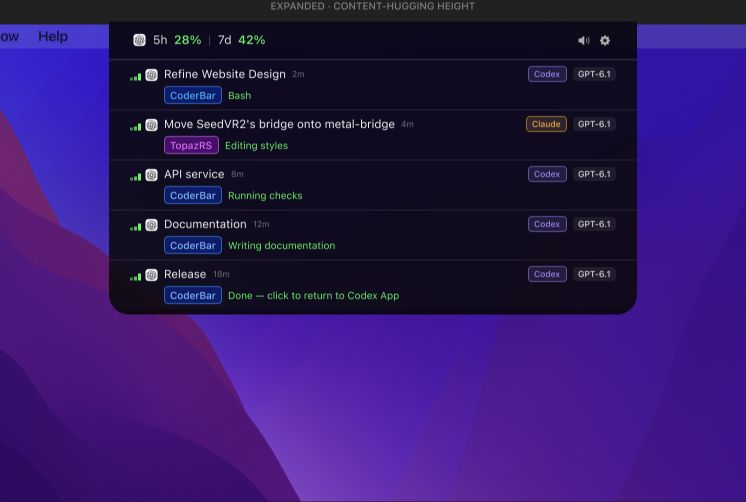

# CoderBar

[Website](https://monomadic.github.io/CoderBar/) · [Download for macOS](https://monomadic.github.io/CoderBar/downloads/CoderBar-macos.zip)

A native macOS notch companion for monitoring **Codex and Claude sessions**. Keep an eye on running work, see which project and model each session belongs to, and click a row to return to the agent app or terminal.

This is [monomadic's fork](https://github.com/monomadic/CoderBar) of [helloyulife/CoderBar](https://github.com/helloyulife/CoderBar), with an English interface, a redesigned floating panel, configurable motion, and reduced background parsing work. It is built with SwiftUI and AppKit.

## App preview

<p align="center">
  
</p>

*Design preview using the supplied 4× artwork. The expanded panel is shown at its default 528-point width within a 746-pixel desktop composition; smaller screens scale it down. Session content is illustrative.*

[Expanded view — 4× PNG](website/public/product/coderbar-expanded-design.png) · [macOS desktop — 4× JPEG](website/public/product/macos-desktop.jpg) · [View on the website](https://monomadic.github.io/CoderBar/#app)

## How you use it

- **Minimized:** a small app icon and animated activity bars sit to the left of the notch; a session-count pill sits to the right. The panel uses the display's notch width rather than leaving a large empty gap.
- **Expanded:** hover over or click the panel to see sessions, projects, current activity, models, and reasoning effort. The height follows the content up to the configured maximum, then scrolls.
- **Return to work:** click a session to activate the associated app, terminal, or tmux pane, depending on the integration. Completed activity is simply labeled **Done**.
- **Respond when supported:** hook integrations can surface approval requests, plan reviews, questions, task plans, and sub-agents. Available controls depend on the agent and event source.
- **Tune it:** open the gear button for display placement, panel size, visible fields, notifications, sound, and hover behavior.

## What changed in this fork

### A smaller, clearer panel

The floating panel was redesigned through Figma and implemented as native views:

- A compact, notch-aware minimized view with no title text.
- A narrower **528 pt** default expanded panel with an opaque near-black surface, a header divider, and no outer window stroke.
- System fonts, regular-weight session titles, and plain elapsed time immediately beside each title.
- Outlined agent badges, neutral gray model badges, and a separate project/activity line.
- Consistent project colors derived from the project name, stable across sessions, ordering, and restarts.
- Activity bars before the app icon in expanded rows; no redundant activity dot or duplicate agent label.
- The installed ChatGPT/Codex app icon when available, with bundled fallback artwork.

The minimized surface retains its translucent appearance. The expanded view stays opaque.

### Adjustable motion

Expansion and collapse keep the panel attached to the notch. Icon animation no longer interpolates its position while the window resizes.

**Settings → General** provides sliders and numeric fields for all four timings, saved between launches:

| Setting | Default |
|---|---:|
| Hover delay | 20 ms |
| Expansion animation | 100 ms |
| Collapse animation | 100 ms |
| Mouse-leave delay | 20 ms |

Each accepts 0–1,000 ms. A reset button restores these defaults. Hover entry works from any direction.

### Less repeated background work

Desktop discovery still polls every **1.5 seconds**, with local hooks supplying low-latency events. Bounded caches reuse parsed Codex/Claude transcript activity and Claude session records when their files have not changed. File changes invalidate cached results; errors and files modified during parsing are not cached. A cancelled discovery loop cannot apply its final result after shutdown.

The portable cache checks cover unchanged files, replacement/truncation, deletion, failed reads, writes during parsing, and eviction. In one synthetic 100-poll run, parsing dropped from 100 times to once: **307 ms uncached versus 8 ms cached**. This measures one parsing path, not overall CPU usage or battery life.

## Build and install

Requires macOS 14+, an Apple silicon Mac, and a compatible Swift toolchain (the package declares Swift tools 5.10).

```bash
git clone https://github.com/monomadic/CoderBar.git
cd CoderBar
zsh Scripts/build.sh --install --open
```

The build compiles the app plus `coder-bar-hook` and `coder-bar-ctl`, then packages `dist/CoderBar.app` and its ZIP. To package existing release binaries without recompiling, run `zsh Scripts/package.sh`. Both scripts accept `--install` (copy to `/Applications/CoderBar.app`) and `--open` (launch the installed copy with `--install`, otherwise the copy in `dist/`). Quit an existing CoderBar instance before installing; installation refuses while it is running.

The bundle uses `Resources/AppIcon.icns`, the `14-space-chocolate-coderbar` concept. The icon is a static bundle resource referenced by Info.plist; no icon generation or runtime override is needed. Packaging and installation apply a Finder custom icon to preserve the transparent wrapper silhouette on macOS Tahoe. The bundle passes strict signature verification before this metadata is added and ordinary verification afterward; strict verification rejects Finder custom-icon metadata.

On a command-line-tools installation whose default SDK cannot build SwiftUI, select an installed compatible SDK explicitly. For example, this checkout has been built with:

```bash
SDKROOT=/Library/Developer/CommandLineTools/SDKs/MacOSX26.5.sdk zsh Scripts/build.sh
```

Use that path only if that SDK is installed on your Mac.

### Agent hooks

Desktop discovery reads local agent indexes. For supported hook events and interactive responses, configure the integrations explicitly:

```bash
/Applications/CoderBar.app/Contents/MacOS/coder-bar-ctl configure
/Applications/CoderBar.app/Contents/MacOS/coder-bar-ctl status
/Applications/CoderBar.app/Contents/MacOS/coder-bar-ctl discover
```

`configure` adds CoderBar alongside existing supported hooks and makes `.coderbar.bak` backups. To remove its integration:

```bash
/Applications/CoderBar.app/Contents/MacOS/coder-bar-ctl deconfigure
```

### Vendored installation

A pinned build is also maintained in [monomadic/config](https://github.com/monomadic/config): executables in `vendor/bin`, bundle resources in `assets/coderbar`, and `scripts/install/install-coderbar.sh` to reconstruct and sign `/Applications/CoderBar.app` without rebuilding Swift. Its README records the source revision.

## Local data

CoderBar reads local session metadata and transcripts; it does not require a CoderBar account or hosted transcript service. Its event server listens on loopback.

- App preferences use macOS `UserDefaults` (`dev.coderbar.app`).
- Hook configuration, port/reply files, and debug output use `~/.coderbar/`.
- Session event history lives in `~/Library/Application Support/CoderBar/events.jsonl`.
- Agent configuration backups stay beside the files changed by the configuration command.

Session titles and other agent content can appear in the panel and local event history. Review screenshots before sharing them.

## Development

```bash
swift build
zsh Scripts/test-file-cache.sh
```

The cache checks use `swiftc` directly and do not require XCTest or full Xcode. Set `SDKROOT` as above if needed. They also print the synthetic parsing benchmark.

| Location | Purpose |
|---|---|
| `Sources/CoderBarKit/` | Discovery, file caches, event server, session store, hooks, activation |
| `Sources/coder-bar/` | SwiftUI views, AppKit panel, settings, and application lifecycle |
| `Sources/coder-bar-hook/` | Agent hook forwarder |
| `Sources/coder-bar-ctl/` | Configure, remove, inspect, and discover commands |
| `Scripts/` | Build, packaging, installation, icon generation, and cache checks |
| `Tests/CoderBarKitTests/` | Portable file-cache regression checks |
| `docs/images/` | Screenshots and historical product artwork |
| `website/` | Product website with current branding, layered app preview, and feature overview |

Opt-in debug variables include `CODERBAR_DEBUG`, `CODERBAR_DEBUG_AUTO_EXPAND`, `CODERBAR_DEBUG_AUTO_COLLAPSE`, `CODERBAR_DEBUG_DISABLE_AUTO_COLLAPSE`, and `CODERBAR_DEBUG_DISABLE_DESKTOP_DISCOVERY`.

The repository's release workflow is configured to build and verify an ARM64 app and publish a GitHub Release on pushes to `main`. See [workflow runs](https://github.com/monomadic/CoderBar/actions) for actual build status and [Releases](https://github.com/monomadic/CoderBar/releases) for available artifacts.

### Website releases

The [website](https://monomadic.github.io/CoderBar/) automatically refreshes after a successful **Build and release CoderBar** workflow or a published/edited GitHub Release. Pages reads the latest stable release's `CoderBar-macos.zip`, checks its byte count and SHA-256 digest when provided, and deploys the matching download link, version, size, and ZIP together. Drafts and prereleases do not replace the stable download. Failed checks leave the existing site intact.

The Download buttons use a version-specific release URL, so the displayed version and size always describe that file. The existing `/CoderBar/downloads/CoderBar-macos.zip` link also remains available. Before the first release, the site uses the verified bundled v0.5.5 archive. To refresh manually, run **Publish website to GitHub Pages** from Actions; no source edits are needed for new releases.
